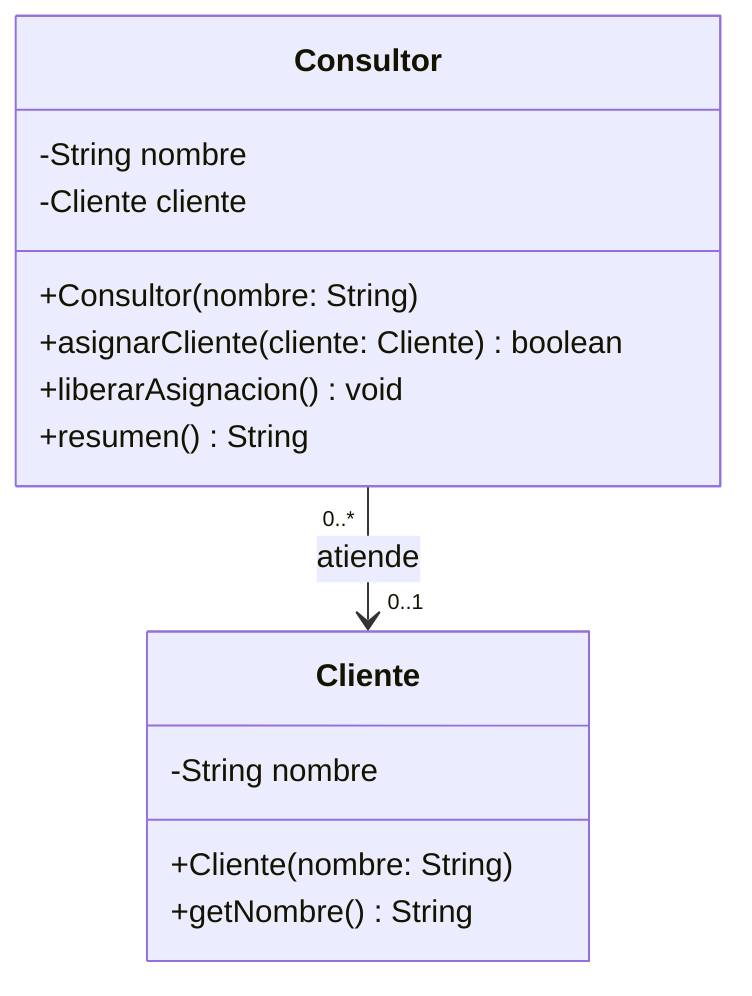
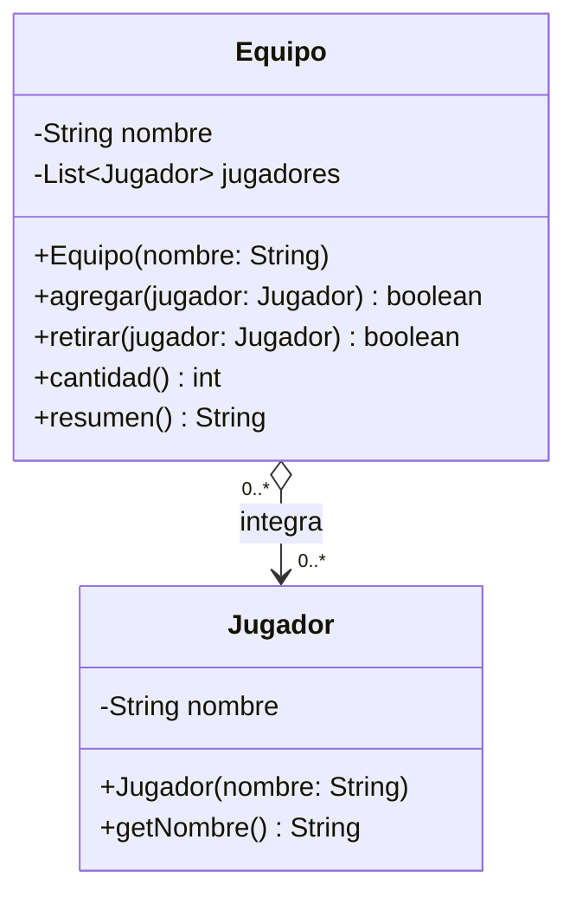
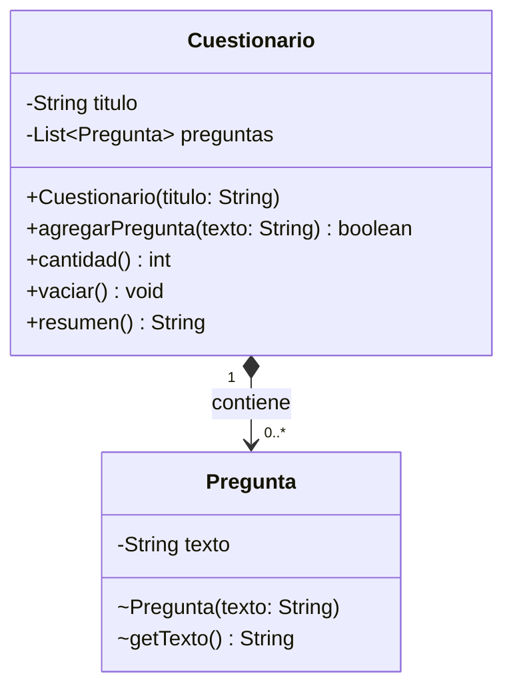
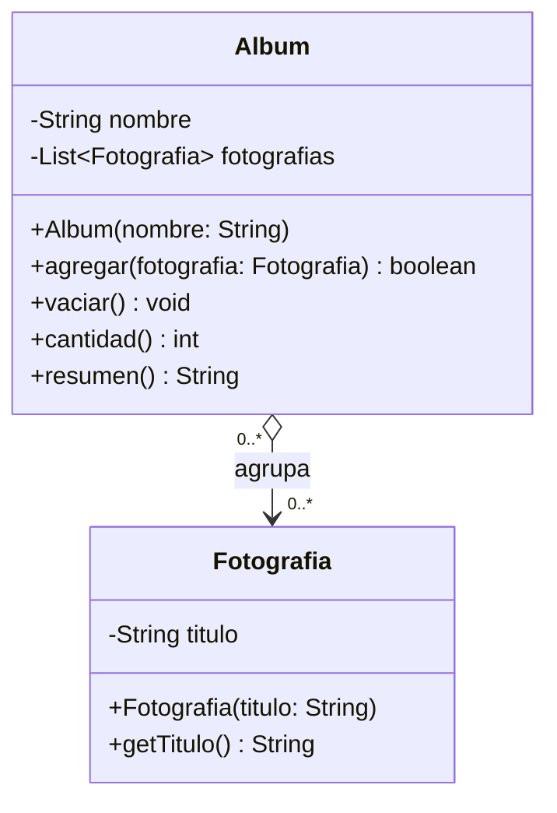
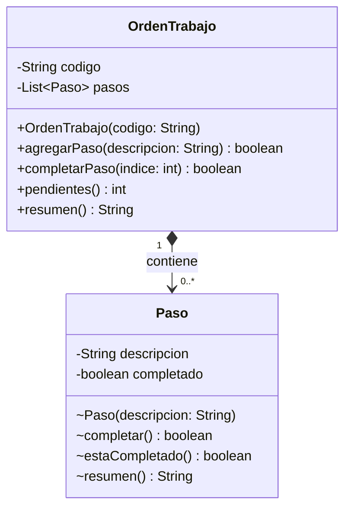

# Sesión 9 · Solución de los labs

Los cinco Main se ejecutaron sin modificaciones con JDK 21 y su salida coincide con la esperada en cada enunciado.

## Investigación común

Fuentes: [uml-diagrams.org · Association](https://www.uml-diagrams.org/association.html) y [OMG UML 2.5.1, §11.5 Associations](https://www.omg.org/spec/UML/2.5.1).

| Concepto | Definición propia |
| --- | --- |
| **Asociación** | Vínculo estructural en el que un objeto conoce a otro y puede colaborar con él, sin que uno sea parte del otro. |
| **Agregación (compartida)** | Asociación todo–parte débil: el todo agrupa partes que existen por sí mismas y que pueden pertenecer a varios todos a la vez. Rombo blanco junto al todo. |
| **Composición** | Asociación todo–parte fuerte: cada parte pertenece a un solo todo a la vez y el todo administra su creación y vigencia dentro del modelo. Rombo negro junto al todo. |
| **Multiplicidad** | Cuántas instancias de una clase pueden vincularse con una instancia del extremo opuesto: `0..1`, `1`, `0..*`, `1..*`. |
| **Navegabilidad** | Dirección en la que se puede consultar el vínculo; se dibuja con una flecha hacia la clase alcanzable. En Java la determina qué clase guarda el campo de referencia. |

---

## Lab 01 · Consultor y cliente

**Clasificación:** asociación dirigida de `Consultor` hacia `Cliente`.

- **¿Todo–parte?** No. El contexto dice explícitamente que el cliente no es una pieza del consultor; solo se le asigna para atenderlo.
- **¿Instancia compartida?** Sí. `ana` y `luis` apuntan al mismo objeto `tienda` al mismo tiempo, por eso el extremo de Consultor es `0..*`.
- **Evidencia:** `Consultor` tiene un único campo `Cliente cliente` (no una lista) que puede ser `null` (estado inicial y tras `liberarAsignacion`), de ahí `0..1`; una asignación válida lo reemplaza. `Cliente` no guarda referencia a Consultor, así que la navegación va en un solo sentido. Liberar a Ana no afecta a Tienda Norte ni a Luis.

**Variación:** la multiplicidad del extremo Cliente pasaría de `0..1` a `1` (exactamente un cliente siempre); seguiría siendo asociación.

---

## Lab 02 · Equipo y jugadores

**Clasificación:** agregación (rombo blanco en `Equipo`), navegable de Equipo a Jugador.

- **¿Todo–parte?** Sí, débil: el equipo es un conjunto deportivo formado por jugadores, pero los jugadores son independientes del equipo.
- **¿Instancia compartida?** Sí. La misma referencia `sara` está en Azul y Rojo; el contexto lo permite (club y selección).
- **Evidencia:** los `Jugador` se crean fuera (en el Main) y `agregar` recibe la referencia; `retirar` solo la quita de la lista de ese equipo y Sara sigue en Rojo y conserva su nombre. No hay mínimo de jugadores (un equipo nuevo tiene 0), de ahí `0..*`. Se rechaza repetir la misma referencia (`==`) en un equipo, pero no se limita a un equipo por jugador. `Jugador` no conoce a Equipo.

**Variación:** el extremo Equipo pasaría de `0..*` a `0..1`, y `agregar` tendría que comprobar que el jugador no esté ya en otro equipo (por ejemplo, que Jugador conozca su equipo actual o que un registro central lo controle).

---

## Lab 03 · Cuestionario y preguntas

**Clasificación:** composición (rombo negro en `Cuestionario`), navegable de Cuestionario a Pregunta.

- **¿Todo–parte?** Sí. Las preguntas son entradas propias del cuestionario; sin él no tienen sentido en el modelo.
- **¿Instancia compartida?** No. Cada `Pregunta` la crea el propio cuestionario y nunca sale de él, así que pertenece a exactamente `1` cuestionario.
- **Evidencia:** `agregarPregunta` recibe un `String`, no una `Pregunta`, y hace `new Pregunta(...)` internamente; la lista es privada y ningún método devuelve la lista ni sus objetos (`resumen` solo devuelve texto); `Pregunta` y su constructor tienen acceso de paquete. `vaciar` elimina las entradas de Java sin afectar a Git. Un cuestionario puede estar vacío (`0..*`).

**Variación:** si las preguntas vienen de un banco externo y se comparten, ya no hay pertenencia exclusiva: habría que pasar a agregación (o asociación) con extremo Cuestionario `0..*`, y `vaciar` ya no representaría el fin de vida de las preguntas.

---

## Lab 04 · Álbum y fotografías

**Clasificación:** agregación (rombo blanco en `Album`), navegable de Album a Fotografia.

- **¿Todo–parte?** Sí, débil: el álbum agrupa fotografías para presentarlas, pero ellas existen antes y fuera de él.
- **¿Instancia compartida?** Sí. `playa` está a la vez en Vacaciones y en Favoritas.
- **Evidencia:** las fotos se crean en el Main antes que los álbumes y `agregar` recibe la referencia; tras `vaciar` Vacaciones, Favoritas conserva Playa y ambas fotos siguen consultables desde las referencias originales. Solo `Album` guarda referencias (`Fotografia` no conoce al álbum). No hay mínimo ni máximo de fotos: `0..*` en ambos extremos.

**Variación:** habría que revisar si cada imagen la crea la ficha a partir de datos, si es exclusiva de una sola ficha y si no se expone hacia fuera; si se cumple, pasaría a composición con extremo Ficha `1`.

---

## Lab 05 · Orden de trabajo y pasos

**Clasificación:** composición (rombo negro en `OrdenTrabajo`), navegable de OrdenTrabajo a Paso.

- **¿Todo–parte?** Sí. Cada paso es parte del trabajo de su orden y no se transfiere a otra.
- **¿Instancia compartida?** No. Si dos órdenes compartieran un `Paso`, completarlo en una lo marcaría completado en la otra, lo que el contexto prohíbe; por eso el extremo OrdenTrabajo es `1`.
- **Evidencia:** `agregarPaso` recibe un `String` y crea el `Paso` dentro; `completarPaso` recibe un índice (no una referencia), valida el rango y delega en el paso; no hay método para insertar un Paso externo ni para obtener la lista; `Paso` tiene acceso de paquete. Completar el índice 0 de OT-01 deja intacta OT-02. Una orden puede no tener pasos (`0..*`). El atributo `completado` es estado del paso, no parte del vínculo.

**Variación:** conviene separar una clase `Tarea` del catálogo (descripción reutilizable, asociada desde varios pasos) del `Paso` de cada orden (con su propio `completado`, en composición), porque reutilizar el mismo Paso compartiría el estado completado entre órdenes.
